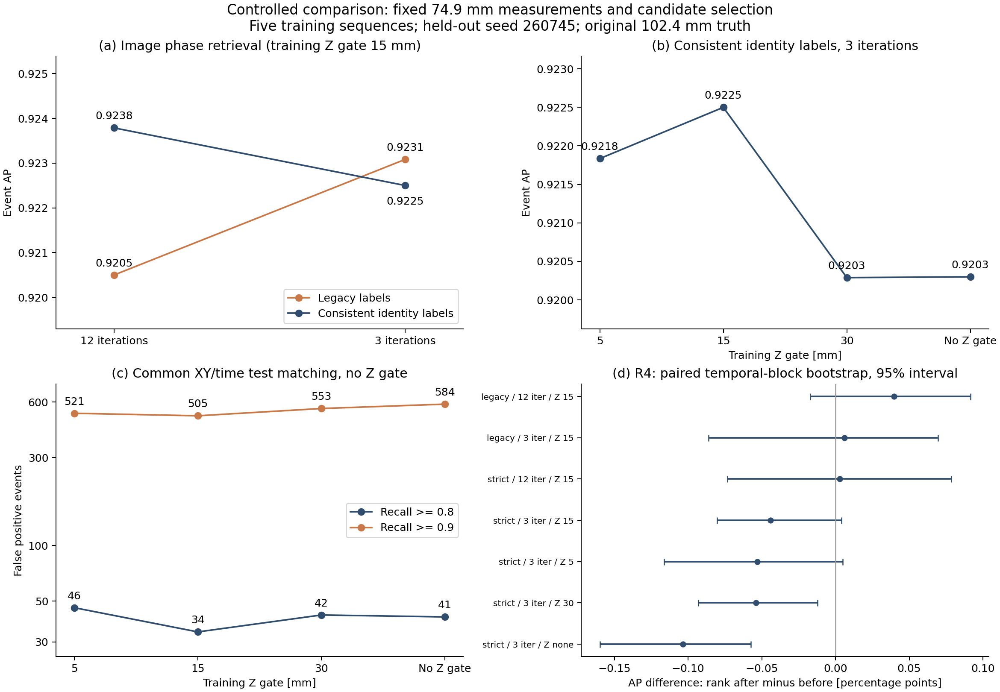
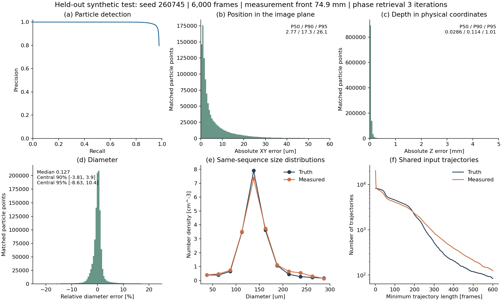

# 新版マテリアルに向けた事前検証

実験実施：2026-10-30。独立検証・取りまとめ：2026-11-01。
対象ブランチは `revision/amt-preflight-20261030`。
添付の `amt_readiness_review_20261026.pdf` と、先行チャット「論文とデータセットの不一致を検証」を踏まえた検証である。
添付資料の修正提案は検討資料として扱い、今回指定された生成奥行き、再構成前端、位相回復回数、比較実験、R7の方針を優先した。

このブランチは、新版の条件と比較結果を確認するためのものである。
同梱の v1.0.1 の数値データと学習済み重みは、旧版を再現する資料として保持している。
新しい102.3 mmの6系列を撮像から再処理したリリースには、まだ置き換えていない。

事前検証の推奨は、生成奥行き102.3 mm・前端74.9 mm・位相回復3回とし、R4は抑制前の順位を維持、R5はID優先規則を全学習段階で統一して学習Z許容差±15 mmを維持する、という組合せである。
R4を抑制後へ変える性能上の利点は今回の3回条件では見られず、Z許容差を変える利点も確認できなかった。
ID優先規則の統一はすべての性能指標を改善する変更ではないため、そのトレードオフを下記に示す。

## 検証した範囲

| 項目 | 今回の扱い |
| --- | --- |
| 生成奥行き | 102.3 mmを明示指定できるよう実装し、全6系列・計36,000フレームを生成して確認 |
| 再構成前端 | 74.9 mmが正しいことを生成条件と全6系列の正解データから確認 |
| 位相回復 | 粒子計測の3回を維持し、衝突画像特徴の12回と3回を固定入力で比較 |
| パディング | 粒子計測1536、衝突画像特徴2048を維持 |
| Fig.7 | 衝突検出に使った同じテスト系列の追跡表から粒子誤差を再計算 |
| 鉛直速度摂動 | 元の `--small-particle-y-jitter` と256 pxのXY外側領域を維持 |
| R4 | 同じ生存候補について、座標重複抑制の前後で順位を付ける比較 |
| R5 | 対応規則の統一と、学習Zゲート5、15、30 mm、Zゲートなしを比較 |
| R7 | 本文の全フレーム・名目体積・ポアソン誤差だけの規約へ変更 |

比較条件は実行前に [protocol.json](../experiments/amt_preflight_20261030/protocol.json) に記録した。
新しい版の処理条件は [revision-profile.json](../experiments/amt_preflight_20261030/revision-profile.json) に分離している。

## 生成奥行きと再構成範囲

主カメラからの距離は `74.9 mm + 生成座標 z` である。
1始まりのスライス番号 `s` に対して、生成座標は `(s−1)×0.1 mm`、主カメラからの再構成距離は `74.9+(s−1)×0.1 mm` となる。
したがって、1,024面の両端は生成座標0–102.3 mm、主カメラ距離74.9–177.2 mmである。
74.9 mmから102.3 mmまでの短い区間ではなく、74.9 mmから奥行き102.3 mmの区間を扱う。

旧64.9 mm前端では、同じ1,024面が生成座標−10–92.3 mmに対応する。
この10 mmのずれは、生成時のカメラ位置と一致しない。
全6系列の正解データで、旧範囲と修正後の範囲を調べた結果は次のとおりである。
粒子点は各フレームにおける粒子中心の観測であり、異なる粒子の総数ではない。

| シード | 観測領域内の粒子点 | 旧64.9 mm前端の範囲外 | 74.9 mm前端でも102.3 mmを超える点 | 旧範囲外の衝突 | 修正範囲外の衝突 |
| --- | ---: | ---: | ---: | ---: | ---: |
| 260740 | 1,200,000 | 87,109 | 0 | 90 | 0 |
| 260741 | 1,200,000 | 87,821 | 32 | 90 | 0 |
| 260742 | 1,200,000 | 92,645 | 6 | 95 | 0 |
| 260743 | 1,200,000 | 97,153 | 625 | 97 | 0 |
| 260744 | 1,200,000 | 93,930 | 326 | 93 | 0 |
| 260745 | 1,200,000 | 92,668 | 18 | 90 | 0 |
| 合計 | 7,200,000 | 551,326 | 1,007 | 555 | 0 |

衝突12,000件はすべて74.9–177.2 mmに含まれる。
一方、旧生成器の奥行きは `1024×0.1=102.4 mm` だったため、前端だけを直しても旧粒子点の1,007点が最後の面を超える。
したがって「前端74.9 mmへの修正」と「生成奥行き102.3 mmへの修正」を合わせて行う必要がある。
元データのハッシュと系列ごとの最小・最大Zは [geometry.json](../experiments/amt_preflight_20261030/results/geometry.json) と [geometry.csv](../experiments/amt_preflight_20261030/results/geometry.csv) に保存した。

新しい生成条件では、seed 260740–260745の全6系列を実際に生成した。
各系列6,000フレーム、毎フレーム200粒子、2,000衝突という条件も満たしている。
XY観測領域外の5,410,882点を含む全12,610,882点のZは0.002738–102.295500 mmで、衝突位置は0.245772–102.099996 mmだった。
観測領域内の7,200,000粒子点、外側からの流入を表す粒子点、衝突12,000件のすべてが指定範囲内にあり、範囲外は0件だった。
粒子位置は連続値であり、自然な運動を0.1 mm単位に量子化していない。
1,024面は、その連続位置を含む再構成面の定義として扱う。

観測領域の外側から粒子を流入させる256 pxのXY余白は保持している。
この外側領域にあることと、Zが再構成範囲外になることは区別している。
生成器は運動を途中でZ境界に反射・固定するのではなく、必要な滞在期間を通じて範囲内に収まる軌道を生成する。

**旧画像と新しい正解データを組み合わせることはできない。**
同じseedでも、生成奥行きの変更によって全6系列の12,000衝突すべてで時刻または位置が変わった。
今回生成したのは数値正解データまでであり、対応するホログラムはまだ描画していない。
検証結果は [revised_generation_all.json](../experiments/amt_preflight_20261030/results/revised_generation_all.json) と [系列別の表](../experiments/amt_preflight_20261030/results/revised_generation_all.csv) を参照。

MinIPには別の注意がある。
既存処理のスライス間引きは2で、実際に投影に使う最後の面は177.1 mmである。
名目上の1,024面の範囲と、投影に使った512面の集合は同じではない。
粒子計測の全深度範囲は74.9–177.2 mmに合わせられるが、新版でMinIPについても両端を厳密に含めるなら、終端177.2 mmを明示的に追加する必要がある。
これはパディングの変更とは独立であり、今回の固定入力比較には混ぜていない。

## 位相回復、R4、R5の比較設計

訓練にはseed 260740–260744、評価には独立したseed 260745を用いた。
各系列は6,000フレーム、2,000衝突である。
テスト系列をモデルの学習には用いていない。
この比較結果だけでZゲートを最適化したとは扱わない。

比較では、74.9 mm前端で計測済みの粒子・追跡表、候補集合、上流スコア、画像特徴を計算する候補の選択を固定した。
既存の102.4 mm生成ホログラムを使用し、Oursの画像特徴について位相回復12回と3回を比較した。
粒子計測とMinIP生成はもともと3回であり、この介入で画像を再計算する対象ではない。
固定候補で各条件の分類器、関係attention、位置・時刻補正器を学習し直した。
新しい正解データから候補選択までを再生成する実験ではないため、最終版の性能を確定する結果ではない。

主評価の対応規則は、全条件で時間差±5フレーム、XY距離350 µm以内、Z条件なしの最大一対一対応に固定した。
APはprecision envelopeの積分、所定再現率でのFPはその再現率を満たす最高しきい値で集計する。
評価時にZゲートも加えた感度表は [evaluation_z_sensitivity.csv](../experiments/amt_preflight_20261030/results/evaluation_z_sensitivity.csv) に分けている。
評価規則を厳しくした結果のAP低下と、学習規則の性能差を混同しない。

R5の「統一規則」は、先行チャットで指定された、候補時刻 `t−1` の両親と `t+1` の娘を使う。
欠測時の補間や別フレームからの持ち越しは行わない。
IDが一致する説明があるイベントでは、それに矛盾する近傍候補を負例にせず損失から除外し、一致する説明がないイベントには空間的fallbackを使う。
同じ規則を分類器と関係attentionに適用し、attentionに実際に渡す上位20候補の集合内でラベルを付け直す。
訓練全体で正例と負例の重みを釣り合わせる。
旧規則との比較は、IDを読む時点、attentionの教師、neutralの扱い、重みの整合を合わせた修正の比較である。
個々の変更の寄与を分離した実験ではない。

学習時のZゲートは5、15、30 mm、なしを比較する。
ここで5 mmは `|Δz|≤5 mm` の許容差を意味し、窓の全幅では10 mmとなる。
関連付けには `(s−1)×100 µm` の物理座標を用い、固定した特徴表自体は旧来の表現を保持した。
この共通の座標原点補正があるため、新しく学習した旧規則・12回の値も、以前の保存モデルのAPを完全に再現する対照ではない。

画像特徴は6系列の808,372候補について3回で再計算した。
全1,508,905候補の集合、非画像特徴、画像を計算するフレーム、欠測箇所は12回の入力と一致した。
画像特徴の計算失敗や非有限値の増加はなかった。
共通成分に属するフレーム数は39,215候補（4.85%）、成分面積は216,019候補（26.72%）で変化した。
特徴値が不変だったという結果ではなく、その変化が検出性能に及ぼす影響を次の比較で調べている。

<!-- COMPARISON_RESULTS_START -->
### 位相回復回数の比較

| 条件 | AP | FP @ recall ≥ 0.8 | FP @ recall ≥ 0.9 | 最大recall |
| --- | --- | --- | --- | --- |
| 旧規則・12回・Z15 | 0.920502 | 50 | 464 | 0.9665 |
| 旧規則・3回・Z15 | 0.923083 | 46 | 468 | 0.9690 |
| ID優先統一・12回・Z15 | 0.923787 | 32 | 532 | 0.9710 |
| ID優先統一・3回・Z15 | 0.922500 | 34 | 505 | 0.9690 |

順位は抑制前に固定し、学習Z許容差は±15 mmとした。

ID優先統一・±15 mmでは、12回から3回への変更でAPが0.001287低下した（0.129パーセントポイント）。
再現率80%のFPは32件から34件に増えたが、再現率90%のFPは532件から505件へ減り、最大F1は0.889529から0.890667へ上がった。
最大recallは0.971から0.969へ下がった。
旧規則では3回のAPが12回より0.002581高く、位相回復回数の影響は対応規則とも関係している。
3回への統一は実装上可能であり、小さなAP低下と運用点での変化を併記して進めるのが妥当である。
新しい102.3 mm画像と候補選択から全処理を再実行した際には、最終性能を改めて確認する。

### R4：順位付けを抑制前から抑制後へ変えた比較

| 条件 | 抑制前 AP | 抑制後 AP | ΔAP（後−前） | FP @ 0.8（前→後） | FP @ 0.9（前→後） |
| --- | --- | --- | --- | --- | --- |
| 旧規則・12回・Z15 | 0.920502 | 0.920873 | +0.000371 | 50 → 50 | 464 → 500 |
| 旧規則・3回・Z15 | 0.923083 | 0.923114 | +0.000030 | 46 → 46 | 468 → 475 |
| ID優先統一・12回・Z15 | 0.923787 | 0.923798 | +0.000012 | 32 → 33 | 532 → 545 |
| ID優先統一・3回・Z15 | 0.922500 | 0.922043 | -0.000457 | 34 → 35 | 505 → 520 |
| ID優先統一・3回・Z5 | 0.921835 | 0.921280 | -0.000555 | 46 → 48 | 521 → 548 |
| ID優先統一・3回・Z30 | 0.920289 | 0.919789 | -0.000500 | 42 → 42 | 553 → 573 |
| ID優先統一・3回・Znone | 0.920300 | 0.919265 | -0.001034 | 41 → 43 | 584 → 610 |

各行で生存候補と補正後の座標は同一で、順位に応じたスコアだけが変わる。

3回・ID優先統一の4条件では、いずれも抑制前のAPが高く、再現率90%のFPも少なかった。
今回学習した7条件すべてで、抑制後への変更によって再現率90%のFPが増えた。
主条件の±15 mmでは、抑制後にするとAPは0.000457低下し、FPは再現率80%で1件、90%で15件増える。

不確かさの確認には、1,000フレームずつの6ブロックを対応させた2,000回の再標本化を使った。
ブロック両端の5フレームを除き、1,980件の正解衝突を対象としている。
この境界除外版での主条件のΔAPは−0.000441、95%区間は［−0.000804, +0.000040］で、0をまたぐ。
Z許容差±30 mmとZゲートなしでは、区間全体が負側だった。
これは同じテスト系列・同じ学習済みモデルに条件付けた区間であり、別系列や別の学習乱数での変動は含まない。
[再標本化の全結果](../experiments/amt_preflight_20261030/results/R4_paired_block_bootstrap.csv)を保存した。

**R4は抑制前に順位を固定する現行順序の維持を推奨する。**
本文には「座標に基づく重複抑制の前に順位を固定し、抑制後に付け直さない」と明記すれば、方法と実装が一致する。
参考として、前端だけを直した3手法の保存予測でも、APの微増とFPの増減は必ずしも一致しなかった。
[既存3手法の比較](../experiments/amt_preflight_20261030/results/R4_existing_controls.csv)も参照できる。

### R5：統一規則・3回での学習Z許容差

| 学習Z許容差 | AP | FP @ recall ≥ 0.8 | FP @ recall ≥ 0.9 | 最大recall |
| --- | --- | --- | --- | --- |
| ±5 mm | 0.921835 | 46 | 521 | 0.9695 |
| ±15 mm | 0.922500 | 34 | 505 | 0.9690 |
| ±30 mm | 0.920289 | 42 | 553 | 0.9670 |
| なし | 0.920300 | 41 | 584 | 0.9680 |

順位は抑制前に固定した。全条件のテスト評価ではZゲートを使用していない。

**R5のZ許容差は、現在の±15 mmを維持するのが妥当である。**
今回のID優先統一・3回条件では、APと再現率80%・90%のFPが±15 mmで最も良かった。
最大recallは±5 mmが0.0005高いが、APは低く、二つの運用点でFPが多い。
テスト1系列の感度比較から普遍的な最適値を求めたとは扱わず、既存値を変える利点が確認できなかったと解釈する。

Zゲートの違いは、主にfallbackの範囲に作用した。
5訓練系列でID一致の説明がある衝突は、±15 mmで5,506件、Zゲートなしで5,508件とほぼ同じだった。
一方、fallbackで扱う衝突は4,114件から4,269件へ、正例候補は106,715行から129,931行へ増える。
[学習ラベル数の内訳](../experiments/amt_preflight_20261030/results/training_gate_label_summary.csv)に全条件を示す。

対応規則の統一自体にもトレードオフがある。
3回・±15 mmで旧規則から統一規則へ変えると、APは0.923083から0.922500、再現率80%のFPは46件から34件、90%のFPは468件から505件となる。
全指標で改善する変更ではないが、分類器と関係attentionの教師定義が一致し、再現率80%のFPが減る。
ID優先規則の統一を新版の方針とし、この性能変化を明記することを推奨する。
本文では学習時の時間・XY・Z条件とID優先/fallbackの扱いを記述し、テスト時の共通XY・時間対応規則とは分けて説明する。

<!-- COMPARISON_RESULTS_END -->

## Fig.7とテスト系列の対応

旧Fig.7の粒子対応表と、74.9 mm前端での衝突検出用入力を照合した。
全1,225,299行でフレームと未平滑化のXY検出位置が完全に一致した。
異なるテスト系列を使っていたことを示す結果ではない。
同じ系列・同じ粒子検出に対し、深度推定や追跡後の値が異なる処理結果が別の表として保存されていた。
照合結果は [fig7_input_identity.json](../experiments/amt_preflight_20261030/results/fig7_input_identity.json) にある。

今回のFig.7案は、衝突候補の生成・特徴計算に使ったraw/smoothed追跡表をそのまま入力として計算した。
1,160,051個の対応粒子点における絶対XY誤差の中央値は2.77 µm、絶対Z誤差の中央値は28.56 µmだった。
Z誤差は物理座標原点を修正した値であり、0.1 mmの原点差を位相回復回数の改善と解釈してはいけない。
この図の粒子計測は位相回復3回で、衝突画像特徴の3回対12回の比較とは独立している。

配置は、合成データの訓練・テスト分割を説明した直後、衝突検出性能の図の前がよい。
本文の案内文は次のようにできる。

> We first evaluate particle measurement and tracking on the held-out synthetic test sequence (seed 260745; 6,000 frames), using the same reconstructed particle trajectories as the collision-detection evaluation. Figure 7 summarizes this upstream measurement accuracy.

キャプション冒頭は、次のように系列と入力の関係を明示する。

> Particle measurement and tracking accuracy on the held-out synthetic test sequence (seed 260745). The reconstructed trajectories evaluated here are also used as inputs to the collision-detection evaluation; all panels refer to this same sequence.

新版では粒子評価と衝突評価の入力manifestを共通にし、seed、分割、再構成条件、raw/smoothed表のハッシュを一度だけ定義する。
別の `paired_tracks_20mm.parquet` を図専用の独立入力として持たせない。
ここに示した図は、旧生成画像を用いた74.9 mm前端の検証図であり、新しい102.3 mm系列の最終図ではない。

## R7：本文の観測曝露と誤差棒

図再現スクリプトの既定値を `manuscript` に変更した。
旧図の厳密な再現には、明示的に `--gravity-convention saved-figure` を指定できる。

| 量 | 本文に合わせた値 |
| --- | ---: |
| 1系列のフレーム数 | 10,917 |
| 全14系列の時間 | 38.2095 s |
| 名目体積 | 10.72693248 cm³ |
| 合計体積時間 | 4.0987072659×10⁻⁴ m³ s |
| 確認済み衝突 | 185件 |
| 観測率 | 4.5136182703×10⁵ m⁻³ s⁻¹ |
| 理論期待件数 | 210.11934 |
| 標準偏差 `sqrt(Λ)` | 14.49549 |
| 1σ内の系列 | 8 / 14 |

密度の時間ブロック再標本化による分散は加えていない。
以前の規約から変えても、1σ内かどうかの系列別判定は変わらなかった。
[R7.json](../experiments/amt_preflight_20261030/results/R7.json)、[Fig.14](../experiments/amt_preflight_20261030/results/figures/figure14_manuscript.png)、[Fig.15](../experiments/amt_preflight_20261030/results/figures/figure15_manuscript.png) を保存した。
これは既存の目視確認185件を固定した規約変更であり、新しい衝突モデルを実験画像に適用し直した評価ではない。

## 実装・検証と次の版に残る作業

生成器に独立した `volume_depth_um` / `--volume-depth-um` を追加し、1,024面と102.3 mmの間隔幅を混同しないようにした。
旧版の乱数系列を再現する既定値は102.4 mmのまま保持し、新版の生成スクリプトが102.3 mmを明示指定する。
新しいacquisition設定では前端74.9 mmと位相回復3回を明示し、段階ごとの既存パディングを保持する。
生成器が出す旧形式の `variables.yaml` は来歴情報として残るため、処理には新版の明示acquisition設定を使う。

順位付けは `lineage_rank_order` で抑制前・抑制後を選べるようにし、旧モデルに対する既定動作は保存した。
意味のある確認として、他軌跡によって上位候補が抑制される例で、生存候補と座標を変えずに順位罰則だけが変わることを試験した。
生成面、物理量、図の規約に関する関連テスト21件が合格した。
比較実験については入力ハッシュ、テスト系列の学習除外、R4での候補不変性、PR表からのAP再計算、独立したSciPy実装による一対一対応を確認した。
7条件の抑制前・抑制後それぞれについて、再現率80%・90%での対応数が独立実装と一致し、[検証結果](../experiments/amt_preflight_20261030/results/verification.json) はPASSだった。

再実行方法と保存物は [実験README](../experiments/amt_preflight_20261030/README.md) を参照。
比較の重み・予測・特徴・新しい粒子正解表は、作業領域の `audit/revision-preflight-20261030/` に保存した。
Gitブランチには、再実行用コード、固定した実験エンジン、数値の要約、入力ハッシュ、図を含める。

新版のデータリリースを完成させるには、決めたR4/R5の規則で次を行う。

1. 生成・検証済みの102.3 mmの6系列に対応する、2カメラのホログラムを描画する。
2. 74.9 mm前端・位相回復3回で粒子計測、MinIP、追跡を再実行し、MinIPの終端面の扱いも明記する。
3. 固定候補の比較から進み、候補選択と画像特徴の選択も含めて3手法を学習し直す。
4. Fig.7と衝突評価を同じテスト入力から作り、図表、モデル来歴、データmanifestを更新する。
5. 実験画像への新モデル適用を行う場合は、利用可能になった生画像で処理し直し、既存185件の評価と区別する。

今回の事前検証の結果を、これらが完了した新版の結果として引用しない。
